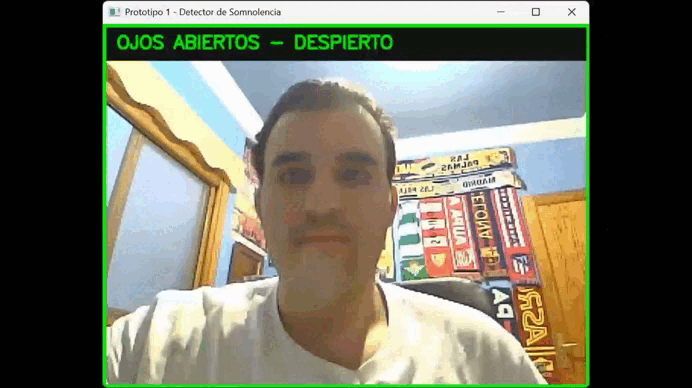

# Práctica 5 VC

Ejercicios de la quinta práctica de laboratorio de VC.

Nicolás Hernández Castro y Gabriel Godoy Navarro - EII ULPGC 26 de noviembre de 2026

## Prototipo 1: Sistema de Detección de Somnolencia

Este primer prototipo consiste en un monitor de somnolencia en tiempo real pensado para prevenir descuidos al volante o durante sesiones prolongadas de estudio. Analizando la entrada de la cámara web, el sistema combina rasgos de apariencia y geometría facial para identificar tanto bostezos como ojos cerrados (microsueños), lanzando avisos visuales dinámicos en pantalla según el nivel de alerta.

### 1. Selección y Adecuación del Conjunto de Datos

Para entrenar el clasificador biométrico, se empleó el conjunto de datos **OPENORCLOSEDEYES (CEW)**, disponible en https://www.kaggle.com/datasets/theabah0/openorclosedeyes/data.

Tras filtrar las imágenes en las que MediaPipe localiza el rostro con suficiente confianza `min_face_detection_confidence=0.4`, se obtuvieron 2.406 muestras válidas equilibradas entre ambas clases:

* **Ojos Cerrados (`ClosedFace`):** 1.176 muestras (48,9%)
* **Ojos Abiertos (`OpenFace`):** 1.230 muestras (51,1%)

Con el fin de reducir la variabilidad espacial y lumínica antes de extraer características, cada imagen pasa por un proceso de normalización geométrica y radiométrica a través de la función `extraer_roi_ocular(frame_bgr)`:

1. **Alineación horizontal:** Se calculan los centros de ambos ojos mediante los landmarks de MediaPipe (`[33, 133]` para el ojo izquierdo y `[362, 263]` para el derecho) y se aplica una transformación afín `cv2.warpAffine` para corregir cualquier inclinación de la cabeza.
2. **Recorte de la región de interés (ROI):** Se extrae un recorte horizontal de ambos ojos proporcional a la distancia que los separa `dist_ojos * 0.95` y se escala a 64x24 píxeles en escala de grises.
3. **Normalización de contraste:** Se utiliza ecualización adaptativa CLAHE `cv2.createCLAHE(clipLimit=2.0, tileGridSize=(4, 4))` para homogeneizar la iluminación de la zona ocular y reducir el impacto de las sombras o reflejos.

### 2. Extracción de Características y Entrenamiento del Modelo

Para no pasarle los píxeles en bruto al clasificador, cada recorte de los ojos se transforma primero en un vector numérico con la función `extraer_caracteristicas(img_gray)` que combina información de forma y textura:

* **HOG (*Histogram of Oriented Gradients*):** Captura la forma y orientación de los bordes (como la curvatura de los párpados, las pestañas y las cejas) trabajando con 9 orientaciones, celdas de 8x8 píxeles y bloques de 2x2.
* **LBP (*Local Binary Patterns*):** Analiza la textura de la imagen en escala de grises `local_binary_pattern(img_gray, P=8, R=1, method="uniform")`, dividiendo el recorte en una cuadrícula de 2x4 celdas para conservar la distribución espacial (diferenciando así el contraste del iris frente a la piel lisa del párpado cerrado).

Una vez extraídas y escaladas estas características `StandardScaler()`, se entrenó un clasificador SVM con kernel RBF `SVC(kernel="rbf", C=10, probability=True)`, evaluando su rendimiento mediante validación cruzada en 5 particiones `StratifiedKFold(n_splits=5, shuffle=True, random_state=42)` utilizando `cross_val_predict(modelo, X, y, cv=skf, n_jobs=-1)` para obtener las predicciones de todo el conjunto sin fuga de datos. Tras comprobar su rendimiento, el modelo se entrenó con el 100% de las muestras `modelo.fit(X, y)` y se guardó en disco (modelo_atencion.pkl) mediante `joblib` para utilizarlo en tiempo real.

Al analizar los resultados obtenidos, se observa que el modelo logra un rendimiento muy sólido y equilibrado:

- **Precisión global y equilibrio entre clases:** El clasificador alcanza un 95% de acierto global (accuracy) sobre las 2.406 imágenes, manteniendo valores prácticamente idénticos de precision, recall y f1-score (entre 0,95 y 0,96) tanto en ojos abiertos como en ojos cerrados. Esto confirma que el modelo no tiene sesgo hacia ninguna de las dos categorías.
- **Análisis de la matriz de confusión:** De las 1.176 muestras de ojos cerrados, el sistema clasifica correctamente 1.114 y solo confunde 62. En el caso de los ojos abiertos, acierta 1.175, cometiendo únicamente 55 fallos.

### 3. Apartado Extra: Comparativa de Modelos Clásicos frente a Red Neuronal

Como apartado extra, se realizó una comparativa para observar cómo se comportan distintos modelos clásicos (SVM, KNN y Random Forest) frente a una red neuronal (MLP) al resolver este mismo problema.

Para evaluar ambos enfoques en igualdad de condiciones, se utilizaron exactamente los mismos vectores de características HOG + LBP estandarizados con `StandardScaler` y la misma validación cruzada de 5 particiones (`StratifiedKFold`), midiendo tanto el acierto como los tiempos de entrenamiento y predicción imagen a imagen (promediada sobre 500 muestras):

Al contrastar los modelos clásicos con la red neuronal se observan diferencias en su comportamiento:

- **Capacidad de clasificación:** El SVM (95,14%) y la Red Neuronal MLP (94,01%) alcanzan un rendimiento muy similar y superior a Random Forest (92,02%) y KNN (91,52%). Esto refleja que mientras KNN se ve afectado por el ruido al comparar distancias directas entre tantos datos, tanto el kernel RBF del SVM como las capas ocultas de la red neuronal aprenden a separar patrones complejos dando más peso a los rasgos relevantes.
- **Velocidad de inferencia en tiempo real:** La Red Neuronal (MLP) es la más veloz prediciendo fotograma a fotograma (0,508 ms/imagen), ya que una vez entrenada solo realiza operaciones matriciales muy ligeras, seguida de cerca por el SVM (1,751 ms/imagen). Por el contrario, otros enfoques clásicos penalizan mucho la latencia en directo, ya que Random Forest (41,372 ms) debe evaluar 100 árboles por imagen y KNN (15,107 ms) tiene que calcular distancias contra las 2.406 muestras de entrenamiento en cada cuadro.
- **Facilidad de uso y configuración:** A nivel de programación, todos resultan igual de sencillos de implementar gracias a la interfaz unificada de `scikit-learn` (`make_pipeline`, `fit` y `predict`). La diferencia está en el ajuste previo, ya que los modelos clásicos funcionan prácticamente listos para usar con muy pocos parámetros (como el número de vecinos en KNN, los árboles en Random Forest o el kernel en SVM) y entrenan en apenas un segundo (entre 0,05 s y 1,30 s). Por su parte, la Red Neuronal (MLP) exige tomar más decisiones de diseño, como definir la arquitectura de capas ocultas, la tasa de aprendizaje o el límite de iteraciones para asegurar su convergencia, además de requerir algo más de tiempo de entrenamiento (2,76 s).

### 4. Demostración en tiempo real

Para llevar el sistema a tiempo real, se carga el clasificador entrenado (modelo_atencion.pkl) junto con el detector facial de MediaPipe y los emojis (durmiendo.png y bostezando.png). En cada fotograma capturado por la cámara web, la función `analizar_rostro_completo` aprovecha una única detección de landmarks para extraer dos señales simultáneas:

- **Detección ocular suavizada:** Se recorta y alinea la franja de los ojos con el mismo preprocesado del entrenamiento, se extraen sus características HOG + LBP y se calcula la probabilidad con el SVM (exigiendo `probs[0] > 0.65` para considerar el ojo cerrado). Para evitar que un parpadeo natural rápido dispare falsas alarmas, las predicciones pasan por una ventana deslizante de los últimos 5 fotogramas `deque(maxlen=5)` mediante votación mayoritaria.
- **Detección geométrica de bostezos:** Se calcula la apertura relativa de la boca dividiendo la distancia vertical de los labios interiores (landmarks 13 y 14) entre el ancho de las comisuras (landmarks 78 y 308). Si esta relación supera el umbral `0.58` en al menos 3 de los últimos 4 fotogramas `deque(maxlen=4)`, se activa el aviso de bostezo.

A partir de ambas señales, el sistema decide el estado dando prioridad al cierre ocular sobre el bostezo y actualiza la interfaz en pantalla:

- **Estado Despierto (`OpenFace`):** Muestra un marco verde alrededor de la imagen y el mensaje `"OJOS ABIERTOS - DESPIERTO"` en la barra superior.
- **Alerta Temprana de Fatiga (`Bostezo`):** Aplica un tinte naranja translúcido sobre el vídeo (`cv2.addWeighted`), cambia el borde a naranja con el texto `"BOSTEZO DETECTADO"` y superpone el emoji `bostezando.png` con un ligero movimiento vertical flotante.
- **Alerta de Microsueño (`ClosedFace`):** Aplica un filtro azulado nocturno sobre la escena, muestra el aviso `"OJOS CERRADOS - DURMIENDO... Zzz"` y anima en pantalla el emoji `durmiendo.png`.

## Prototipo 2: Director de Orquesta Facial

Este segundo prototipo convierte el rostro del usuario en un instrumento musical que se controla sin usar las manos. A partir de la cámara web, el sistema interpreta la inclinación de la cabeza, los gestos faciales y la emoción del usuario para tocar melodías en tiempo real, cambiar de instrumento, añadir percusión y generar efectos visuales en pantalla.

### 1. Elección de Detectores y Arquitectura del Sistema

Para que el prototipo funcione de forma fluida, se descartaron detectores clásicos o con pocos puntos clave y se diseñó de esta manera:

- **Detector facial y malla de landmarks (`MediaPipe FaceLandmarker`):** Se descartaron alternativas vistas en la práctica como Viola-Jones que no proporciona landmarks y pierde la cara al inclinarla, MTCNN que está limitado a 5 puntos básicos, insuficientes para medir apertura bucal o guiños o `dlib` con 68 puntos 2D y mayor complejidad de instalación en Windows. En su lugar, se configuró `face_landmarker.task` en modo vídeo (`min_face_detection_confidence=0.6`, `min_tracking_confidence=0.6` y `output_face_blendshapes=True`), logrando 30 FPS con 478 landmarks faciales y coeficientes musculares (los *blendshapes*) en cada fotograma.
- **Análisis de emociones en segundo plano (`DeepFace`):** Dado que la inferencia de emociones con redes neuronales es costosa y congelaría el vídeo si se ejecutara en cada fotograma, se separó en un hilo independiente (`threading.Thread`) mediante `analyze_emotion_async(face_crop)` cada 5 fotogramas. Se pasa únicamente el recorte facial escalado a 96x96 píxeles con `detector_backend='skip'`, aprovechando la detección previa de MediaPipe para no duplicar trabajo.
- **Audio nativo (`WindowsMidiSynth`):** Frente a reproducir archivos `.wav` pregrabados o instalar librerías externas de sonido, se optó por acceder directamente al sintetizador MIDI de Windows a través de `ctypes.windll.winmm`, dando una respuesta inmediata sin latencia, cambio instantáneo de instrumento y control continuo del volumen.

### 2. Uso de los Landmarks y Mapeo Musical

La malla de 478 landmarks de MediaPipe no solo localiza la cara, sino que actúa como la base visual y de recorte de todo el prototipo:

1. **Cálculo de la región de interés (ROI) para `DeepFace`:** A partir de los valores mínimos y máximos (`x_min`, `x_max`, `y_min`, `y_max`) de los 478 landmarks proyectados a píxeles, se construye el recuadro exacto del rostro y se amplía con un margen del 25% por cada lado. Este margen es necesario para que `DeepFace` reciba la frente, las cejas y la barbilla completas, mejorando el acierto sin necesidad de usar un segundo detector facial.
2. **Inclinación de cabeza y selección de nota (landmarks `33` y `263`):** Se toman las esquinas exteriores de ambos ojos para calcular el ángulo de inclinación con `np.arctan2` y dibujar una línea guía sobre los ojos. El rango entre -25 y 25 grados se divide en 7 notas de la escala pentatónica de Do (`Do 4`, `Re 4`, `Mi 4`, `Sol 4`, `La 4`, `Do 5` y `Re 5`), elegida porque todas sus notas suenan armónicas entre sí incluso sin conocimientos musicales.
3. **Anclaje de la interfaz en tiempo real (landmarks `1` y `13`):** La función `draw_conductor_hud` utiliza la punta de la nariz (landmark `1`) como centro móvil del arco semicircular de notas, de modo que la interfaz sigue siempre a la cabeza del usuario. Asimismo, usa el punto central del labio superior (landmark `13`) como origen de las ondas circulares que se expanden mientras suena una nota.
4. **Control gestual mediante *blendshapes* derivados de la malla facial:**
   - **Activación del sonido y volumen (`jawOpen`):** En lugar de medir la apertura labial en píxeles (sensible a la distancia respecto a la cámara), se utiliza `jawOpen`. Al superar `0.25`, la nota suena con una intensidad proporcional a la apertura; al cerrar la boca, se detiene.
   - **Golpe de platillo (`eyeBlinkLeft` y `eyeBlinkRight`):** Para distinguir un guiño intencionado de un parpadeo normal o de un entrecerrado leve del ojo abierto, se comprueba que un ojo supere `0.45`, el otro quede por debajo de `0.35` y la diferencia entre ambos sea mayor de `0.30`. Así funciona con cualquiera de los dos ojos (evitando problemas por el efecto espejo `cv2.flip`), lanza percusión en el canal MIDI 9 junto a un destello blanco y aplica una espera de 0,7 segundos para evitar repeticiones.
   - **Cambio de instrumento por emoción (`get_calibrated_emotion`):** Se combinan los *blendshapes* de sonrisa, cejas, ojos y comisuras con la clasificación asíncrona de `DeepFace` para cambiar entre 5 estados diferenciados:
     - **Neutral (`neutral`):** Flauta travesera (verde).
     - **Feliz (`happy`):** Piano de concierto (dorado).
     - **Triste (`sad`):** Violonchelo (azul).
     - **Enfadado (`angry`):** Órgano (rojo).
     - **Sorpresa (`surprise`):** Arpa (violeta).

### 3. Pruebas en Directo y Decisiones de Robustez

Durante las pruebas con la cámara web se detectaron distintos problemas prácticos que guiaron los ajustes finales del prototipo:

- **De razones geométricas 2D a *blendshapes*:** Inicialmente se probaron métricas manuales entre landmarks 2D como distancias de cejas, ojos y boca normalizadas por la altura facial o la distancia interocular. Sin embargo, al inclinar la cabeza hacia arriba o abajo cambiaba la perspectiva 2D y aparecían falsos positivos (especialmente en sorpresa). Pasar esas detecciones a los *blendshapes* de MediaPipe eliminó los fallos por perspectiva y distancia, manteniendo los landmarks explícitos donde la geometría directa sí es robusta (ángulo ocular, recorte facial y anclaje gráfico).
- **Bloqueo de la emoción al tocar:** Abrir la boca para emitir una nota deformaba la expresión y provocaba cambios no deseados hacia sorpresa o felicidad en mitad de una melodía. Por ello, tanto la llamada a `DeepFace` como la actualización del instrumento quedan bloqueadas mientras `is_playing` está activo.
- **Selección de clases y ajuste de pesos en `DeepFace`:** Se descartaron emociones difíciles de fingir de forma natural frente a una webcam (`fear` y `disgust`), que generaban ruido al girar la cabeza, limitando el sistema a las 5 emociones más claras. Además, como el modelo tiende a sobrepredecir `neutral` en interiores, se redujo su peso (`0.75`) y se reforzaron `sad` y `angry` (`1.3`), consiguiendo transiciones rápidas y estables.

### 4. Conclusión

El desarrollo de este prototipo demuestra que, en aplicaciones interactivas en tiempo real, el principal reto no es solo detectar el rostro, sino gestionar el equilibrio entre velocidad y estabilidad. Durante las pruebas se comprobó que depender únicamente de una red neuronal como `DeepFace` introduce retardo y errores por iluminación, mientras que usar distancias manuales en 2D falla cuando cambia la inclinación o la distancia a la cámara. La solución más eficaz ha sido combinar ambos mundos usando los landmarks y *blendshapes* de MediaPipe para el control instantáneo y dejar `DeepFace` como apoyo asíncrono en segundo plano.

El resultado final cumple el objetivo de convertir gestos faciales sencillos en una herramienta musical intuitiva, fluida y sin dependencias externas de audio. No obstante, el prototipo presenta dos limitaciones claras: el sintetizador actual depende de la API MIDI de Windows (`winmm.dll`) y la precisión en expresiones suaves sigue condicionada por la luz del entorno. Como posible ampliación, bastaría con sustituir la salida de audio por una librería multiplataforma y permitir la detección simultánea de varias caras (`num_faces > 1`) para interpretar melodías o acordes entre varias personas a la vez.