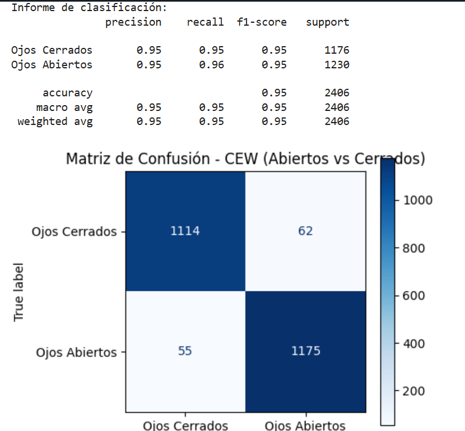

# Práctica 5 VC

Ejercicios de la quinta práctica de laboratorio de VC.

Nicolás Hernández Castro y Gabriel Godoy Navarro - EII ULPGC 26 de noviembre de 2026

## Prototipo 1: Sistema de Detección de Somnolencia

Este primer prototipo consiste en un monitor de somnolencia en tiempo real pensado para prevenir descuidos al volante o durante sesiones prolongadas de estudio. Analizando la entrada de la cámara web, el sistema combina rasgos de apariencia y geometría facial para identificar tanto bostezos como ojos cerrados (microsueños), lanzando avisos visuales dinámicos en pantalla según el nivel de alerta.

### 1. Selección y Adecuación del Conjunto de Datos

Para entrenar el clasificador biométrico, se empleó el conjunto de datos **OPENORCLOSEDEYES**, disponible en https://www.kaggle.com/datasets/theabah0/openorclosedeyes/data.

Tras filtrar las imágenes en las que MediaPipe localiza el rostro con suficiente confianza `min_face_detection_confidence=0.4`, se obtuvieron 2.406 muestras válidas equilibradas entre ambas clases:

* **Ojos Cerrados (`ClosedFace`):** 1.176 muestras (48,9%)
* **Ojos Abiertos (`OpenFace`):** 1.230 muestras (51,1%)

Con el fin de reducir la variabilidad espacial y lumínica antes de extraer características, cada imagen pasa por un proceso de normalización geométrica y radiométrica a traves de la función `extraer_roi_ocular(frame_bgr)`:

1. **Alineación horizontal:** Se calculan los centros de ambos ojos mediante los landmarks de MediaPipe (`[33, 133]` para el ojo izquierdo y `[362, 263]` para el derecho) y se aplica una transformación afín `cv2.warpAffine` para corregir cualquier inclinación de la cabeza.
2. **Recorte de la región de interés (ROI):** Se extrae un recorte horizontal de ambos ojos proporcional a la distancia que los separa `dist_ojos * 0.95` y se escala a 64x24 píxeles en escala de grises.
3. **Normalización de contraste:** Se utiliza ecualización adaptativa CLAHE `cv2.createCLAHE(clipLimit=2.0, tileGridSize=(4, 4))` para homogeneizar la iluminación de la zona ocular y reducir el impacto de las sombras o reflejos.

### 2. Extracción de Características y Entrenamiento del Modelo

Para no pasarle los píxeles en bruto al clasificador, cada recorte de los ojos se transforma primero en un vector numérico con la función `extraer_caracteristicas(img_gray)` que combina información de forma y textura:

* **HOG (*Histogram of Oriented Gradients*):** Captura la forma y orientación de los bordes (como la curvatura de los párpados, las pestañas y las cejas) trabajando con 9 orientaciones, celdas de 8x8 píxeles y bloques de 2x2.
* **LBP (*Local Binary Patterns*):** Analiza la textura de la imagen en escala de grises `local_binary_pattern(img_gray, P=8, R=1, method="uniform")`, dividiendo el recorte en una cuadrícula de 2x4 celdas para conservar la distribución espacial (diferenciando así el contraste del iris frente a la piel lisa del párpado cerrado).

Una vez extraídas y escaladas estas características `StandardScaler()`, se entrenó un clasificador SVM con kernel RBF `SVC(kernel="rbf", C=10, probability=True)`, evaluando su rendimiento mediante validación cruzada en 5 particiones `StratifiedKFold(n_splits=5, shuffle=True, random_state=42)` utilizando `cross_val_predict(modelo, X, y, cv=skf, n_jobs=-1)` para obtener las predicciones de todo el conjunto sin fuga de datos. Tras comprobar su rendimiento, el modelo se entrenó con el 100% de las muestras `modelo.fit(X, y)` y se guardó en disco (modelo_atencion.pkl) mediante `joblib` para utilizarlo en tiempo real.

Al analizar los resultados obtenidos, se observa que el modelo logra un rendimiento muy sólido y equilibrado:

- **Precisión global y equilibrio entre clases:** El clasificador alcanza un 95% de acierto global (accuracy) sobre las 2.406 imágenes, manteniendo valores prácticamente idénticos de precision, recall y f1-score (entre 0,95 y 0,96) tanto en ojos abiertos como en ojos cerrados. Esto confirma que el modelo no tiene sesgo hacia ninguna de las dos categorías.
- **Análisis de la matriz de confusión:** De las 1.176 muestras de ojos cerrados, el sistema clasifica correctamente 1.114 y solo confunde 62. En el caso de los ojos abiertos, acierta 1.175, cometiendo únicamente 55 fallos.
